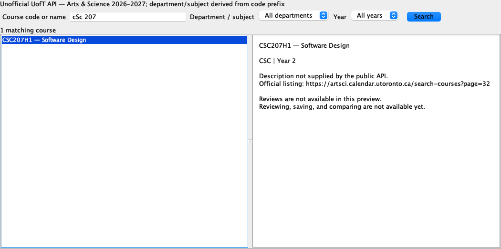

# Rate My Course

A student course browser. This first UC1 increment provides code/title search,
department/subject and year filters, result counts, and a selected-course metadata
preview backed by the [Unofficial UofT Course API (2026–2027)](https://github.com/Meh494/Unofficial-UofT-Course-API-26-27).
UC1 / US1 lead: Savir Singh. Other team use cases are not implemented by this PR.

## Run with the API

The Java application requires JDK 11 or later, Maven, and a graphical desktop.
The separate API server requires Python 3.10 or later. Its repository documents
local hosting; a GitHub repository URL is not an HTTP API base URL.

In a separate terminal, clone and start the API using its public catalogue:

```sh
git clone https://github.com/Meh494/Unofficial-UofT-Course-API-26-27.git course-api
cd course-api
python3 -m venv .venv
. .venv/bin/activate
python -m pip install -r requirements.txt
COURSE_CATALOG_PATH=public_catalog/catalog.json python -m uvicorn api:app --host 127.0.0.1 --port 8000
```

Ensure `python3` is version 3.10 or later before creating that environment. Then,
from this Java project's root:

```sh
mvn verify
mvn compile exec:java
```

The default API base is `http://127.0.0.1:8000/`. To use another running instance:

```sh
mvn compile exec:java -Dcatalogue.api=http://127.0.0.1:8765/
```



## API scope and mappings

This increment loads **Arts & Science** records using
`GET /courses?faculty=artsci&page_size=100&page=N`. It follows every page before
publishing the catalogue. The tested public snapshot yielded **5,368 courses
across 54 requests**. This is a calendar snapshot, not live enrolment information.

The API provides no department or year fields. For this increment, department /
subject means the alphabetic subject prefix, such as `CSC`; year is the first
numeric digit of the Arts & Science course code. It is a course level, not a
student's personal year of study. Faculty is not treated as a department.

The public API has empty description fields. The preview explicitly states that
no description was supplied and displays the provided official listing URL.
It does not invent descriptions or reviews. Numeric credits and additional source
fields are not mapped in this first metadata preview.

A complete validated snapshot is cached **in memory for the application's lifetime**.
Search/filter rules run locally against it, which preserves code normalization
such as `csc 207` and avoids downloading 54 pages per Search. Restart to refresh
from the API. This is not disk persistence.

HTTP errors, request timeouts, invalid JSON, malformed records, incomplete pages,
or inconsistent pagination cause a loading failure. Partial results are never
published or cached. Retry starts again at page one. There is no automatic demo
fallback. Each request has a five-second timeout, and loading has a sixty-second
overall deadline. The adapter rejects totals above 20,000 as a pagination guard.

## Offline demo / local file

```sh
mvn compile exec:java -Dcatalogue.mode=demo
```

This explicitly selects eight labelled, illustrative records. It requires no API
server. For an external UTF-8 TSV, copy the bundled file and supply its path:

```sh
cp src/main/resources/demo-courses.tsv /tmp/rmc-demo-courses.tsv
mvn compile exec:java -Dcatalogue.path=/tmp/rmc-demo-courses.tsv
```

The file's header is `code`, `name`, `department`, `year`, `description`, separated
by tabs. Each row has those five fields. Year must be 1–4; codes must be unique
(case-insensitive). Embedded tabs/newlines in fields are not supported. A
header-only file is a valid empty catalogue. TSV mode reloads on each Search.
The file path takes precedence over demo mode; otherwise API mode is the default.

## Current scope

Search is case-insensitive and supports partial codes/titles, whitespace
normalization, AND-combined filters, blank-query browsing, stable code sorting,
result counts, selection, and metadata preview. Submit with Search or Enter.
No matches leaves the inputs editable. Catalogue failure shows an error and Retry.

**Review loading and its failure handling are deferred**, along with the real
review/save/compare action entry points. This is the first UC1 increment, not the
complete detail screen. Searching performs no writes to catalogue storage.

## Validation and demo

`mvn --batch-mode verify` runs 46 JUnit cases and Checkstyle. GitHub Actions runs
the same command on push/PR. HTTP tests use a loopback server and need no external
network or Python process. A local integration smoke also loaded the full public
Arts & Science catalogue through the actual Python API and exercised the browser.

To demonstrate API failure/recovery, start the Java app while its configured API
is stopped. Observe an error, start the API, then press Retry. After a successful
load the application uses its cache, so stopping the server then does not make
subsequent local searches fail.

See [architecture, UC1 coverage, rubric mapping, and demo](docs/uc1-search.md).
