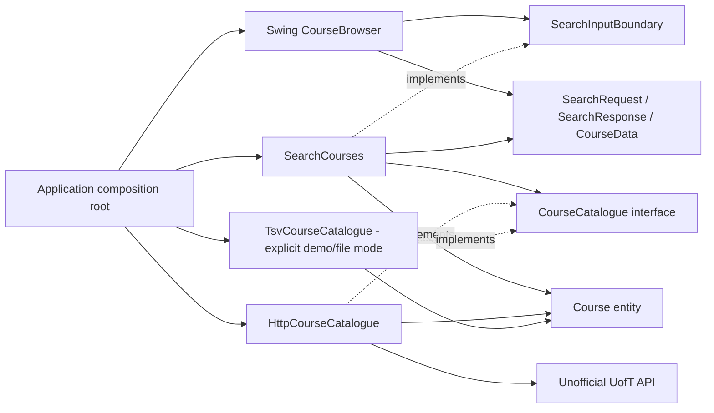

# UC1 increment: API-backed search and metadata preview

## Student-facing specification

A student submits a course code or part of a title and may choose department/subject
and year filters. Matching courses appear with a count, code, and name. Selecting
one shows its metadata. Blank queries browse within the selected filters. No
matches leaves the search editable. Catalogue failures show an error and Retry
instead of an empty-catalogue message. Searching leaves stored course data unchanged.

## Acceptance coverage

| UC1 requirement | This increment | Evidence |
| --- | --- | --- |
| Code/name input and optional department/year | Implemented using subject prefixes and code levels for API data | Browser and search tests |
| Explicit Search submission | Implemented, also Enter | Browser smoke/demo |
| Normalize input; combine filters | Implemented | `SearchCoursesTest` |
| Count and code/name per result | Implemented | Browser smoke/demo |
| Select a result and display metadata | Implemented | Output-data test and browser smoke |
| Display available reviews | Deferred | Explicit unavailable message, no fabricated reviews |
| Review/save/compare actions | Deferred integration with UC2–UC4 | No fake working actions |
| Empty query and no matches | Implemented | Search tests and browser smoke |
| Catalogue failure and retry | Implemented, including failed API pages | HTTP/search tests and browser smoke |
| Review failure retains metadata | Deferred with review loading | Follow-up UC1 increment |
| Stored course data unchanged | Implemented | Read-only ports, immutable values, byte comparison test |

## Architecture



Arrows indicate source dependencies, except the labelled API service connection.
The entity has no outward dependencies. The use-case package owns both boundaries
and output data and imports no Swing, file, HTTP, or JSON libraries. HTTP and TSV
adapters implement the use-case-owned port. `Main` wires concrete implementations.
The view collects inputs and renders response data. `SwingWorker` invokes the
synchronous use-case boundary off the event thread and returns UI updates to it.
The first slice combines input and presentation adaptation in the Swing class;
a separate presenter can be extracted if presentation rules grow.

**Dependency inversion:** `SearchCourses` depends on `CourseCatalogue`, supplied
at construction. The API adapter was added without changing any search rules.
Tests substitute in-memory, failing, file-backed, and HTTP-backed catalogues.

**Single responsibility:** course values hold metadata, the interactor applies
search rules, the HTTP adapter owns pagination/JSON mapping, the TSV adapter loads
files, and the view manages Swing.

**Pattern:** a read-only Repository port has interchangeable HTTP and TSV Adapters.
Describe the actual implementation and its extension point in the presentation.
This alone does not establish the rubric's exceptional pattern criterion.

## API integration decisions

The adapter follows the supplied repository's `/courses` contract, requesting
Arts & Science records in pages of 100. Every page must have consistent total,
page number, page size, expected record count, unique codes, and valid mapped
fields. Any failure discards the partial load. A successful immutable snapshot
is retained in memory; there are no per-search HTTP calls after that.

Department/subject is derived from the course prefix (`CSC`), and year level
from the first number (`CSC207H1` -> 2). These are documented application mappings,
not fields claimed to be supplied by the API. Scope is Arts & Science; unrelated
faculty code conventions are not silently coerced into this model.

The API's public description fields are empty. The preview identifies unavailable
descriptions and includes the supplied official listing URL. It does not manufacture
narrative metadata. Credits and other optional metadata await a richer detail model.

The base URL is configurable. The supplied repository documents a local server;
no public hosted base URL is assumed. README commands start the real API with its
public dataset. Demo mode is an explicit choice, never a hidden error fallback.

## Verification

```sh
mvn --batch-mode verify
```

This runs **46 JUnit cases** (including parameterized cases) and the repository's
explicit Checkstyle configuration. GitHub Actions uses the same command. Tests
need no external service: the HTTP adapter suite starts a temporary loopback server.

Coverage includes normalization with a Turkish locale, partial titles, filters,
sorting, empty catalogues, no matches, immutable output, missing/malformed data,
unchanged file bytes, pagination, incomplete pages, HTTP errors, timeouts,
interruption, snapshot caching, and retry after a failed later page. Checkstyle
enforces selected naming/import/brace/tab/line-length rules, not all code quality.

Local integration verification additionally ran the actual Python API against
its public catalogue. Its health endpoint reported 6,497 total records, and the
Java adapter fetched all **5,368 Arts & Science records across 54 pages**. The Swing
smoke checked normalized CSC207 search, metadata selection, no matches, year
filtering (1,045 year-two records), and combined CSC/year-two filtering (10 records).
A deliberately failing boundary checked the UI's failure/retry rendering; actual
HTTP failure/recovery is covered by the loopback tests. The README screenshot
comes from the real API-backed metadata selection. GUI checks are not part of CI.
Remote GitHub Actions results must be checked after publishing the branch.

## Two-minute demo

1. Start the API using the README instructions; launch the Java app.
2. Point out the loaded Arts & Science catalogue count.
3. Search ` cSc 207 `; select the result and show metadata and its official source.
4. Search `software` to show partial title matching.
5. Clear the query, choose subject `CSC` and year 2, then Search: ten results in
   the tested snapshot.
6. Search `not-a-course`: a clear no-match message appears; inputs remain editable.
7. For failure recovery, restart the app while the API is stopped, observe its
   error, start the server, and Retry. Successful loads are cached for the session.
8. Show the Repository port, the unchanged search interactor, and a failure test.

## Supplied rubric

| Area | Evidence contributed | Remaining team responsibility |
| --- | --- | --- |
| Demo | Runnable API-to-search-to-metadata flow and recovery demo | Integrate reviews and all team use cases; rehearse |
| Specification | Student-facing behavior and UC1 acceptance mapping | Keep overall MVP/user stories current |
| Clean Architecture | Inward dependencies, owned ports, diagram | Review integration as app grows |
| SOLID/design | Concrete DIP/SRP examples and Repository/Adapter | Explain extensibility and team pattern choices |
| Code quality | Tests, enforced Checkstyle, CI, focused PR | Peer review and actual CI evidence |
| API usage | Actual HTTP catalogue consumption, pagination, mapping, failure handling | Explain integration and demonstrate the running API |
| Persistence | File catalogue loading; API snapshot only cached in memory | Demonstrate application saving and loading in another use case |
| Presentation | Screenshot, diagram, and demo outline | Slides, delivery, timing, and questions are team work |

The rubric evaluates the whole project and presentation. This PR cannot guarantee
a score. External API integration does not by itself establish data persistence.

## Next UC1 increment

Add a course-detail use case with a review-reader port. Load metadata independently
from reviews. Represent no reviews and failed review loading as different states;
retain metadata on review failure and provide review-only Retry. Then connect the
UC2/UC3/UC4 actions to their real entry points. Extend metadata with optional
credits/source fields and agree on authoritative department naming if available.
